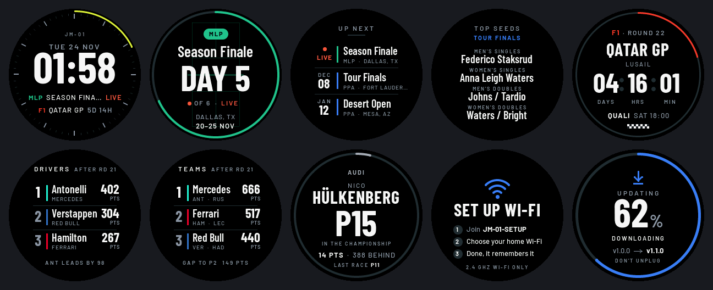

# JM-01 firmware

Pickleball and F1 desk display for James, running on the **Waveshare ESP32-S3-LCD-1.28** (round, non-touch).



## What it does

- **Eight faces, 8 seconds each:** Clock, Next event, Up next, Top seeds, F1 countdown, Drivers, Teams, His driver.
- **First start:** shows the Wi-Fi setup face and opens a Wi-Fi network called **JM-01-SETUP**. Join it with a phone, tap **Configure WiFi** and pick the home Wi-Fi. To choose his driver, tap **Setup** on the same page and type a three-letter code (for example VER, NOR, HAM). It remembers both.
- **Settings later:** on the same Wi-Fi, open **http://jm01.local** and use *Setup* to change his driver. Some Android phones don't support `.local` names; use the IP address from the router instead.
- **Data:**
  - F1 race times and standings come from the free [Jolpica F1 API](https://github.com/jolpica/jolpica-f1) every 3 hours.
  - Pickleball events and seeds come from `schedule.json` in your GitHub repo every hour.
- **Updates itself:** it checks your GitHub releases a minute after starting and every night around 3 am, and installs anything newer.
  - A new version has to download data and keep running for 90 seconds. If it crashes, or hasn't done that within 10 minutes, the bootloader switches back to the previous version.
  - A version that was rolled back is never installed again. Publish a higher version number with the fix.
  - Rollback also happens if the update arrives while his internet is down for more than 10 minutes. The next nightly check won't retry that version, so publish the same build under a higher number.
- **Night mode:** the screen dims from 23:00 to 07:00. Times are UK time and change automatically for summer time.

## 1. One-time setup

1. Install [VS Code](https://code.visualstudio.com/) and the **PlatformIO** extension. Or run `pip install platformio` for the command line.
2. Make a **public** GitHub repo called `jm01`. Upload `schedule.json` from this folder to the repo root.
3. Edit `include/config.h`:
   - `GH_OWNER`: your GitHub username.
   - `GH_REPO`: change it if you named the repo something else.
   - `LCD_ROTATION`: change it later only if the picture is upside down.

> **Windows tip:** keep this project in a short path such as `C:\jm01`. LVGL has deep folders, and very long paths break the build.

## 2. First flash (USB)

Plug the board into your PC with USB-C, then run:

```powershell
pio run -t upload
```

To watch the logs:

```powershell
pio device monitor
```

Logs show what it downloaded, for example `[net] F1: 23 races, 22 drivers, 11 teams`.

Check these on the real board before it goes in the case:

- **Rotation:** with the USB tab pointing down, the picture should be upright. If not, change `LCD_ROTATION` and flash again.
- **Colours:** red should look red. If colours are inverted, change `p.invert` in `src/display.cpp`.
- **Text size and brightness:** check them at desk distance.

## 3. Publishing an update (no cable needed)

1. Make your changes, then bump `FW_VERSION` in `include/config.h`, for example to `1.0.1`.
2. Build it:

   ```powershell
   pio run
   ```

3. On GitHub, create a release tagged `v1.0.1` and attach `.pio/build/jm01/firmware.bin`. The asset must be named exactly **firmware.bin**. With the GitHub CLI:

   ```powershell
   gh release create v1.0.1 .pio/build/jm01/firmware.bin --title "v1.0.1"
   ```

The device installs it overnight, or within a minute of its next restart. While it installs it shows the Updating face.

**Always test a new version over USB on your own board first.** Rollback protects against versions that crash or can't get online. It can't catch a version that runs but looks wrong.

## 4. Updating the pickleball schedule

Edit `schedule.json` on GitHub (the web editor is fine). The device picks it up within an hour.

```json
{ "tour": "PPA", "name": "Tour Finals", "city": "Fort Lauderdale, FL", "start": "2026-12-08", "end": "2026-12-13" }
```

- `tour`: `PPA` or `MLP`.
- Dates: UK dates. `end` is the last day of the event.
- `seeds`: the number one seed in each event at the next big tournament. `event` must match an event `name`.

The events and seeds in the file now are **placeholders**. Replace them with the real schedule.

## Project layout

| Path | What |
|---|---|
| `include/config.h` | All settings: GitHub repo, pins, rotation, brightness, timings |
| `src/ui.cpp` | The faces (a port of the browser preview, same coordinates) |
| `src/net.cpp` | Wi-Fi setup, settings page, downloads, updates, rollback |
| `src/parse.cpp` | JSON to data (schedule, Jolpica) |
| `src/display.cpp` | GC9A01 panel driver (LovyanGFX) and LVGL |
| `src/ca_roots.h` | Root certificates for HTTPS (GitHub, Jolpica) |
| `src/fonts/` | Barlow fonts converted for LVGL (`node tools/make_fonts.mjs` regenerates them) |
| `test_native/` | PC check: runs the parsers on saved data and renders every face to an image |

## Checking on a PC without the board

`test_native/build.sh` compiles the real parsers and drawing code with a desktop compiler. The program it builds reads saved Jolpica responses (`test_native/data/`) and `schedule.json`, then writes each face as an image. That's how `docs/faces_render.png` was made.

You need the MinGW compiler once. Then run `pio run` first so the libraries are downloaded. Run these from Git Bash in this folder:

```bash
pio pkg install -g -t platformio/toolchain-gccmingw32
bash test_native/build.sh .pio/libdeps/jm01/lvgl .pio/libdeps/jm01/ArduinoJson/src build_native
export PATH=~/.platformio/packages/toolchain-gccmingw32/bin:$PATH
mkdir -p renders && build_native/jm01_native.exe test_native/data schedule.json renders HAM
python test_native/sheet.py renders faces.png
```

- The last argument of `jm01_native.exe` is the driver to show on the His driver face.
- To test with fresh data, save the four URLs from `F1_BASE` in `config.h` into `test_native/data/` under the same file names.

## Hardware notes

| What | Value |
|---|---|
| Display | GC9A01A over SPI. DC 8, CS 9, CLK 10, MOSI 11, RST 12, backlight 40 |
| Logs | Through the CH343 USB-UART chip. USB-CDC is off on purpose |
| Memory | 16 MB flash, 2 MB PSRAM. Two 6.25 MB app slots for updates; this build uses about 1.6 MB |

These pins are for the **non-touch** board. The touch version (ESP32-S3-Touch-LCD-1.28) uses different backlight and reset pins. If that's the one that arrives, check Waveshare's wiki and update `config.h`.
